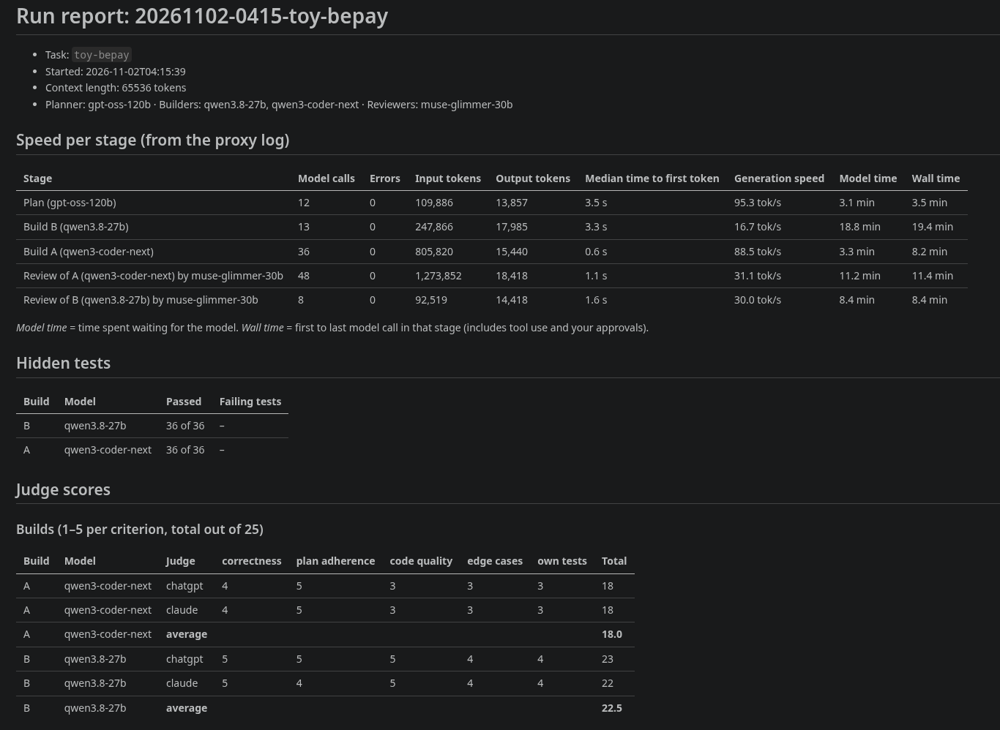
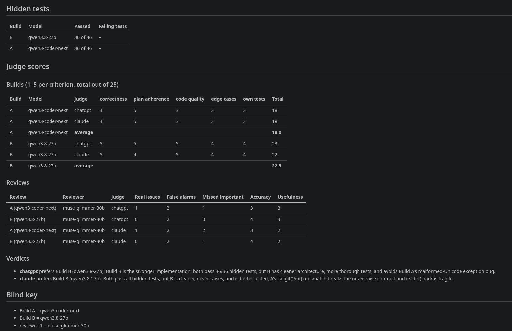

# relaybench



<details>
<summary>The rest of this report: reviews, verdicts and the blind key</summary>



</details>

*One real run of the toy task on a MacBook Pro (M5 Max, 128 GB unified memory), from a pre-release
version of the harness. It shows what a report looks like; one run isn't a ranking of these models.
[That run's full report](https://github.com/onckelinx/relaybench/blob/86a38bb/examples/REPORT.md). A newer real report and its caveats are in [examples/](examples/).*

**Test local coding models the way you would actually use them: as a relay.**

One model writes a plan. Several models build from that same frozen plan. Other models review each
build without knowing who wrote it. Hidden tests and independent judges score the results, and a
logging proxy measures the speed of every call.

```
              ┌──► builder 1 ──► hidden tests ──► reviewer(s), blind ──┐
planner ──►  plan.md                                                   ├──► judges ──► REPORT.md
             (frozen)
              └──► builder 2 ──► hidden tests ──► reviewer(s), blind ──┘
```

## Why

Benchmarks tell you how a model answers isolated problems. Local coding raises different questions:

- Which model should plan, and which should build? A large model may plan well but be too slow to
  iterate. A fast one may build well from a good plan and flounder without one.
- Does a model finish a real agent loop, with tools and its own tests, or does it get stuck?
- What do you get for the wait, measured in tokens per second, time to first token and total time?
- Is a local reviewer's feedback accurate, or mostly false alarms?

relaybench gives each model one role and holds everything else constant, so the answers are
comparable. [METHODOLOGY.md](METHODOLOGY.md) explains the design and, just as important, its limits.

It tests models *through an agent you already use*. It is not an agent. You open each stage's folder
in your coding agent (the [manual guide](GUIDE-MANUAL.md) uses Cline as its example) and tell it to follow
the instructions there. Any agent that can talk to an OpenAI-compatible URL works. If yours has a
command-line mode, [`run`](#unattended-runs) can do the whole run for you.

## Which guide do I need?

There are two ways to run it, and each has its own step-by-step guide.

| | Manual | Unattended |
|---|---|---|
| **What you do** | Drive the agent through each stage in your editor | Start one command and walk away |
| **You need** | An editor agent, such as Cline in VS Code | A command-line agent, such as Cline's CLI |
| **Over SSH** | Needs a remote editor session | Yes, with `tmux` |
| **Who approves commands** | You, or your agent's settings | Nobody |
| **Status** | Used with real models, on an earlier version | One real toy run so far, with Cline's CLI on macOS |
| **Guide** | [GUIDE-MANUAL.md](GUIDE-MANUAL.md) | [GUIDE-UNATTENDED.md](GUIDE-UNATTENDED.md) |

The quickstart below is the short version of the manual way.

## 5-minute quickstart

You need Python 3.9+, Git, a coding agent, and a model server with at least one model. LM Studio is
the default; any OpenAI-compatible server works.

```bash
git clone https://github.com/onckelinx/relaybench.git
cd relaybench
python3 -m venv .venv            # Windows: python -m venv .venv
source .venv/bin/activate        # Windows: .venv\Scripts\activate
pip install -r requirements.txt

python pipeline.py init          # lists your models and writes pipeline.json
python proxy/llm_proxy.py        # in a second terminal (activate the venv there too); leave it running
python pipeline.py check         # back in the first terminal
```

Point your agent at the proxy once: base URL `http://127.0.0.1:1235/v1`, model `local-model`,
and any non-empty API key. Then run the pipeline with one rhythm: **`next`, do what it says, repeat.**

```bash
python pipeline.py new-run       # uses the toy task by default
python pipeline.py next          # switches model and prints the folder to open
```

In your agent, open that folder, start a new session, and send `Follow the instructions in PROMPT.md`.
When it finishes, run `next` again. It tells you when to run `freeze`, `test`, `blind`, `packet`,
`judge` and `report`, and `status` shows where you are at any time.

The setup takes about five minutes if your models are already downloaded. A toy run then takes
as long as your models need, often 30–60 minutes. The result is `runs/<run-id>/REPORT.md`.
See [examples/](examples/) for a real report.

**Try it with no model at all.** The test suite runs the full pipeline against a mock server, with a
script playing the agent. It takes a few minutes and needs no GPU:

```bash
python -m pytest
```

## Unattended runs

The steps above are the manual way, and they keep working as they are. There is also a second way:
one command that does everything, with no editor and nobody watching.

```bash
python pipeline.py run
```

You give it a command-line agent in `pipeline.json`, and it starts the proxy if needed, keeps the machine
awake, runs the agent once per stage, and goes on through tests, blinding, packet, judges and report.
If it's interrupted, the same command resumes the run. A stage that fails or gets stuck is recorded in the
report, and the rest of the run carries on.

```json
"agent": {
  "command": ["my-agent", "--some-auto-approve-flag", "Follow the instructions in PROMPT.md"],
  "stage_timeout_s": 3600,
  "idle_timeout_s": 600
}
```

- **Read this first: nobody approves what the agent does.** Model-written commands run with your
  privileges, so use a container or VM if that matters to you. See [Security](METHODOLOGY.md#security).
- **Judges:** only `api` judges can run unattended. With `paste` or `human` judges, `run` writes the report
  and lists who's still open. Fill those in, then run `report` again.
- **The plan isn't read by a person** before it is frozen.
- **Scores from different agents don't compare directly**, so compare runs made the same way. The report
  records the mode and the agent command. Keep API keys out of the command, since the report shows it.
- **Status:** one real run so far: the toy task with Cline's CLI 3.0.74 and LM Studio on macOS, with `paste`
  judges and no failed stages. Failure handling, `api` judges and other agents have only been tested with a
  scripted stand-in.

[GUIDE-UNATTENDED.md](GUIDE-UNATTENDED.md) goes through it step by step, including failure handling and
[what to do about sleep and lids](GUIDE-UNATTENDED.md#keeping-the-machine-awake).

## Commands

| Command | What it does |
|---|---|
| `init` | Lists available models and writes `pipeline.json` interactively |
| `check` | Checks that everything is installed, running and configured |
| `models` | Lists the models the server offers |
| `new-run [--task name]` | Starts a run with its own folder |
| `next` | Starts the next stage, or tells you which command is next |
| `status` | Shows the current run and what comes next |
| `freeze [--force]` | Freezes `plan.md` and creates one Git repo per builder |
| `test [--show]` | Runs the hidden tests on every build (scores stay hidden unless `--show`) |
| `blind [--force]` | Anonymises builds as A, B, C… and creates the review folders |
| `packet` | Creates the judge packet |
| `judge [--force]` | Sends the packet to `api` judges |
| `report` | Collects speed, tests, scores and integrity flags into `REPORT.md` |
| `run [--task name] [--allow-sleep]` | Does all of the above unattended, or resumes an unfinished run |
| `start <stage>` | (Re)starts one stage |
| `load <label>`, `smoke [label]` | Switches to a model by hand; sends it a test message |

`freeze --force` and `blind --force` don't delete earlier results: they move whatever depends on them
to a `_stale-<time>` folder. `judge --force` asks the `api` judges again and replaces their answers.

## Configuration

`init` writes `pipeline.json`, which Git ignores. To edit by hand, copy
[`pipeline.example.json`](pipeline.example.json). Set `RELAYBENCH_CONFIG` to use another file.

| Key | Meaning | Default |
|---|---|---|
| `backend.type` | `lmstudio` or `openai-compatible` | `lmstudio` |
| `backend.url` | Server URL, with or without `/v1` | `http://127.0.0.1:1234` |
| `backend.api_key_env` | *Name* of an environment variable holding the server's key | none |
| `backend.context_length`, `backend.gpu` | Passed to `lms load` (LM Studio only) | `65536`, `max` |
| `proxy_port` | Port of the logging proxy | `1235` |
| `served_model_name` | The one model name your agent uses | `local-model` |
| `runs_dir`, `logs_dir`, `results_dir`, `tasks_dir` | Folders; relative to this repo, or absolute | `runs`, `logs`, `results`, `tasks` |
| `task` | Default task | |
| `test_timeout_s` | Limit for one build's hidden test suite | `600` |
| `planner` | One `{label, model}` | |
| `builders` | One or more `{label, model}` | |
| `reviewers` | Zero or more `{label, model}` | |
| `judges` | Zero or more judges, see below | |
| `agent.command` | The agent's command line, for `run` only. See [Unattended runs](#unattended-runs). | |
| `agent.stage_timeout_s` | Most time one stage may take | `3600` |
| `agent.idle_timeout_s` | Stop a stage after this long with no model call running or starting | `600` |

`label` is the short name used in stage names and reports. `model` is the server's id for the model.

**Backends.** With LM Studio and its `lms` command, the harness loads each stage's model under the
shared name and sets the context length itself. With any other server, it has no load step: the proxy
rewrites the model name in each request instead, so the server must be able to serve the model by
name, and context length stays a server setting. See [Backends in the guide](GUIDE-MANUAL.md#backends).

**Judges** can be mixed freely:

```json
"judges": [
  { "label": "web-chat", "type": "paste" },
  { "label": "cloud-api", "type": "api", "base_url": "https://api.example.com/v1",
    "model": "some-model", "api_key_env": "JUDGE_API_KEY" },
  { "label": "colleague", "type": "human" }
]
```

| Type | How it works |
|---|---|
| `paste` | You paste the packet into a web chat and paste the answer into a score file |
| `api` | `python pipeline.py judge` sends the packet to an OpenAI-compatible API. With a local model server, this is the only command that sends data off your machine on its own. |
| `human` | A person reads the packet and fills in a score file created for them |

API keys are only ever read from environment variables. They are never written to the config.

## Tasks

Three are included, in rising difficulty: `toy-bepay` (toy), `cron-next` (medium) and `wal-kv`
(hard). Adding your own takes a `TASK.md`, optional `starter/` files and pytest `hidden_tests/`.
[tasks/README.md](tasks/README.md) documents the format.

## Requirements and platform status

- **Python 3.9 or newer.** The harness uses only the standard library.
- **pytest**, from `requirements.txt`, for the hidden tests and this repo's own tests.
- **Git.**

**Tested on macOS/Apple Silicon only** with real models and a real agent. Beyond that:

| Platform | Status |
|---|---|
| macOS (Apple Silicon) | Where real-model runs have been done |
| Linux | The full pipeline passes against the mock server. No real-model run yet. |
| Windows | Written to work (paths, encodings, read-only Git files, `lms.exe`), but **never run**. Reports welcome. |

**Safety.** Agents and hidden tests run model-written code with your user's privileges, and the
agent's commands are not sandboxed. Use a container or VM if that matters to you, and read
[what this does and doesn't protect against](METHODOLOGY.md#security).

## Repository layout

| Path | What it is |
|---|---|
| `pipeline.py` | All commands |
| `proxy/llm_proxy.py` | Sits between agent and server; logs tokens and timing of every call |
| `prompts/` | Instructions for planner, builders, reviewers and judges |
| `scoring/scoresheet.md` | How judges score |
| `tasks/` | Test tasks |
| `tests/` | Mock server, scripted agent, reference solutions and end-to-end tests |
| `examples/` | A real report, and a mock one in the current format |
| [`GUIDE-MANUAL.md`](GUIDE-MANUAL.md) | Full walkthrough of a manual run |
| [`GUIDE-UNATTENDED.md`](GUIDE-UNATTENDED.md) | Full walkthrough of an unattended run |
| [`METHODOLOGY.md`](METHODOLOGY.md) | Why it works this way, and known limitations and biases |

## How this was made

The code was implemented with AI coding agents under the author's direction.

## License

[MIT](LICENSE)
